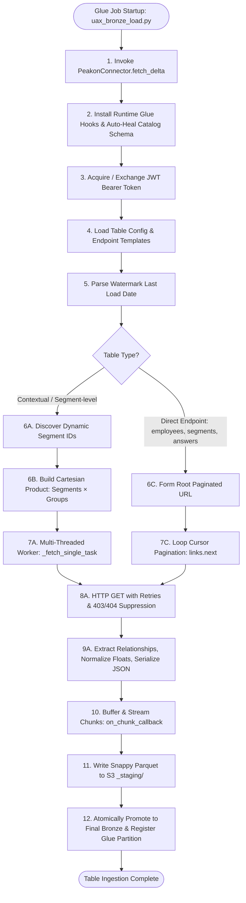

# Workday Peakon Ingestion: Technical Execution Flow & Function Reference

This document provides a comprehensive, step-by-step technical breakdown of the Workday Peakon ingestion process in the **Bronze Layer** of the data pipeline. It explains the execution lifecycle—from AWS Glue job startup to S3 Parquet landing—and documents the operational responsibility of every function and method in [`bronze/script/connectors/peakon.py`](file:///c:/Users/Aditi%20Sachdeva/Downloads/Data-pipeline-test-pipeline/Data-pipeline-test-pipeline/bronze/script/connectors/peakon.py).

---

## 1. High-Level Ingestion Flow

The ingestion pipeline executes as an AWS Glue Python Shell job (`glue-bronze-peakon-{env}`) managed by [`bronze/script/uax_bronze_load.py`](file:///c:/Users/Aditi%20Sachdeva/Downloads/Data-pipeline-test-pipeline/Data-pipeline-test-pipeline/bronze/script/uax_bronze_load.py). For each configured table, `uax_bronze_load.py` invokes `PeakonConnector.fetch_delta(...)`.



---

## 2. Chronological Step-by-Step Execution Lifecycle

Here is the exact order of operations when a Peakon table is ingested:

### Step 1: Orchestrator Invocation (`uax_bronze_load.py`)
* The AWS Glue Python Shell job begins by parsing command-line parameters (`--SOURCE_SYSTEM peakon`, `--ENV dev`, `--SOURCE_TABLE_NAME <table_name>`).
* It pulls API credentials from AWS Secrets Manager (`uax-datalake/peakon-credentials-{env}`).
* It looks up the dynamic connector mapping in `connectors/__init__.py` and calls `PeakonConnector.fetch_delta(...)`.

### Step 2: Runtime Catalog Protection & Self-Healing (`_install_runtime_glue_hooks` & `_sync_glue_table_schema`)
* **Why it runs first:** Peakon API returns scores as mixed types (e.g., `8` as an integer and `8.25` as a float). If partition 1 is created as `BIGINT` and partition 2 has decimals, AWS Athena fails with `HIVE_PARTITION_SCHEMA_MISMATCH`.
* `PeakonConnector._install_runtime_glue_hooks()` dynamically monkey-patches Glue column type inference in memory so any numeric column defaults to `double`.
* `PeakonConnector._sync_glue_table_schema()` inspects the Glue Data Catalog for the current table and automatically widens any metric/score columns from `int`/`bigint` to `double` across both the table definition and all existing historical partitions.

### Step 3: Authentication & Token Caching (`_get_bearer_token`)
* Inspects the secret key `peakon_api_token` (or `api_token`).
* If the token is already a Bearer JWT (starts with `ey` and contains two dots), it is used directly.
* Otherwise, the connector checks its 24-hour in-memory cache (`_jwt_cache`). If not cached or within 60 seconds of expiration, it executes a `POST /api/v1/auth/application` call with payload `{"token": clean_token, "persists": True}` to exchange the application access token for a valid JWT.

### Step 4: Configuration Resolution (`ConfigLoader`)
* Retrieves the specific table block from [`bronze/script/config/bronze_config.json`](file:///c:/Users/Aditi%20Sachdeva/Downloads/Data-pipeline-test-pipeline/Data-pipeline-test-pipeline/bronze/script/config/bronze_config.json).
* Resolves the API endpoint, question sets (`groups`), extra query parameters (`extra_query`, e.g., `include=question.category`), default query parameters (`interval=quarter&observations=true&participation=true`), and page size (`per_page`, default 2000).

### Step 5: Watermark Timestamp Parsing (`_parse_ts`)
* Reads `last_load_date` and parses it into a UTC-aware Python `datetime` object.
* **Cold Starts & Full Pulls:** If `last_load_date` is empty or begins with `1900` (which is configured for `employees`, `segments`, and score tables), `is_full_load` is flagged as `True`, disabling date cutoff skipping.

### Step 6: Dynamic Routing (Branch A vs Branch B)

#### Branch A: Contextual / Segment-Dependent Tables (`scores_by_category`, `scores_by_question`, `engagement_overview`, `engagement_drivers`)
1. **Dynamic Segment Discovery (`_get_dynamic_segment_ids`):**
   * **Tier 1 (Memory):** If `segments` table was extracted earlier in the same run, reuses discovered IDs in `_cached_segment_ids`.
   * **Tier 2 (S3 Parquet):** Scans the latest partition in S3 (`_read_segment_ids_from_s3`) and reads IDs in-memory via pandas.
   * **Tier 3 (API Fallback):** Calls `GET /api/v1/segments?per_page=2000` with cursor pagination.
   * Applies testing limiter (`segment_limit` / `max_segments`, default 50 for testing, `0` for full run) and prepends priority contexts (`start_with`).
2. **Task Construction:** Computes Cartesian product of `(segment_id, group)` for the 9 configured question groups (`engagement`, `health_wellbeing`, `transformation_change`, `diversity_inclusion`, `onboarding`, `exit`, `environmental_social_governance`, `values`, `other`).
3. **Multi-Threaded Execution:** Dispatches tasks across `ThreadPoolExecutor(max_workers=8)` executing the inner worker `_fetch_single_task`.

#### Branch B: Direct Single Endpoints (`segments`, `employees`, `answers`)
* Formats base URL: `{base_url}/api/v1/{endpoint}?per_page={batch_size}`.
* Iterates sequentially through pages by following the JSON:API cursor link (`links.next`).

### Step 7: HTTP Transport with Resilient Backoff (`_execute_request_with_retry`)
* Sends requests with `Authorization: Bearer <jwt>`.
* **Rate Limits (HTTP 429):** Reads `Retry-After` header or performs exponential backoff (`5 * attempt` seconds) and retries.
* **Server Errors (HTTP 5xx):** Retries up to 4 times with exponential backoff (`2 ** attempt` seconds).
* **Domain Suppression (HTTP 403 / 404):** Peakon returns HTTP 403 when a segment has fewer than 5 respondents (confidentiality threshold), and HTTP 404 when a group has no data. The connector suppresses these status codes and returns `{}` instead of failing the pipeline.

### Step 8: Payload Transformation & Schema Normalization
Inside each page / task:
1. **Unpack Root & Attributes:** Extracts `id`, `type`, attaches `segment_id`, `context_id`, and `group`, and unpacks `attributes`.
2. **Preserve Relationships:** Loops `relationships` and populates `rel_{rel_name}_id` (e.g., `rel_attribute_id`, `rel_employee_id`), `rel_{rel_name}_type`, and multi-link JSON arrays `rel_{rel_name}_ids`.
3. **Side-Load Taxonomy:** For `peakon_categories` and `peakon_questions`, calls `build_lookup_records(...)` to extract deduplicated taxonomy records from the `included` block.
4. **Deep Float Normalization (`_normalize_metric_floats`):** Recursively inspects all nested metric keys (`scores.mean`, `scores.size`, `standardDeviation`, `difference`, `benchmarks`, `participation`, `enps`) and converts values to Python `float`.
5. **Serialize Complex Structures:** Iterates over all top-level keys; any remaining nested `list` or `dict` (e.g. benchmark `observations`) is converted to a JSON string via `json.dumps()` to prevent Parquet flattening from multiplying rows.
6. **Delta Cutoff:** If `is_full_load` is `False`, compares record timestamp against `cutoff_dt` and drops older records.

### Step 9: Memory-Safe Streaming to S3 (`on_chunk_callback`)
* Extracted records are accumulated into a buffer.
* Once the buffer reaches `s3_chunk_size` (10,000 records), `on_chunk_callback(records_buffer, part_number)` is triggered.
* Writes a Snappy-compressed Parquet chunk directly into the isolated staging path:
  `s3://{bronze_bucket}/metadata/bronze/_staging/peakon/{table_name}/{execution_id}/part-00001.snappy.parquet`.

### Step 10: Atomic Promotion & Catalog Sync
* Once all pages / tasks finish, any remaining buffered records are flushed.
* `uax_bronze_load.py` atomically copies all chunk files from staging to the final Bronze partition:
  `s3://{bronze_bucket}/bronze/data/peakon/{table_name}/_ingested_at={YYYY-MM-DD HH:MM:SS}/`.
* Registers the new `_ingested_at` partition in the AWS Glue Data Catalog.
* Updates the watermark state metadata in S3 (`metadata/bronze/state_peakon.json`).

---

## 3. Comprehensive Function-by-Function Reference

| # | Function / Method Name | Scope | Line Range | Purpose |
| :-: | :--- | :--- | :-: | :--- |
| **1** | `_parse_ts` | Module Helper | Lines 44–66 | Parses varied timestamp strings/epochs into UTC-aware datetime for watermark filtering. |
| **2** | `build_lookup_records` | Module / Static | Lines 69–113 | Extracts side-loaded taxonomy entities (`categories`, `questions`) from JSON:API `included` arrays with relationship IDs. |
| **3** | `_get_bearer_token` | ClassMethod | Lines 130–189 | Manages authentication, token exchange via `/api/v1/auth/application`, and 24-hour JWT caching. |
| **4** | `_execute_request_with_retry` | ClassMethod | Lines 191–254 | Executes HTTP GET calls with exponential backoff on HTTP 429/5xx and clean suppression of HTTP 403/404. |
| **5** | `_read_segment_ids_from_s3` | ClassMethod | Lines 256–292 | Tier 2 discovery: reads segment IDs from the latest Bronze S3 Parquet partition in memory via pandas. |
| **6** | `_normalize_metric_floats` | ClassMethod | Lines 294–348 | Deep-recursively converts all numeric metric fields to Python `float` to guarantee Athena schema consistency. |
| **-** | `_walk_and_normalize` | Inner Function | Lines 313–346 | Recursive dictionary/array traverser inside `_normalize_metric_floats`. |
| **7** | `_install_runtime_glue_hooks` | ClassMethod | Lines 350–398 | Dynamically monkey-patches `uax_bronze_load.py` in memory to force `double` catalog types and trigger auto-sync. |
| **-** | `peakon_safe_infer` | Runtime Hook | Lines 370–378 | Intercepts Glue type inference to map all numeric values to `double`. |
| **-** | `peakon_safe_sync` | Runtime Hook | Lines 384–395 | Wraps catalog synchronization to trigger schema widening immediately post-creation. |
| **8** | `_sync_glue_table_schema` | ClassMethod | Lines 400–538 | Direct AWS Glue API client that widens `bigint`/`int` metrics to `double` in tables and all historical partitions. |
| **9** | `_get_dynamic_segment_ids` | ClassMethod | Lines 540–635 | Orchestrates 3-tier segment discovery (Memory ➔ S3 Parquet ➔ API `/api/v1/segments`) with `segment_limit` support. |
| **10** | `fetch_delta` | ClassMethod (Main) | Lines 637–1274 | Main public extraction interface; coordinates routing, multi-threading, delta filtering, and S3 streaming. |
| **-** | `_fetch_single_task` | Inner Worker | Lines 815–1024 | Executes an individual `(segment, group)` query slice, extracts relationships, normalizes floats, and buffers records. |

---

### Detailed Analysis of Each Function

#### 1. `_parse_ts(ts_val: Any) -> Optional[datetime]`
* **Signature:** `def _parse_ts(ts_val: Any) -> Optional[datetime]`
* **Location:** Lines 44–66
* **Inputs:** `ts_val`: string, int, float, or None representing a timestamp.
* **Returns:** Timezone-aware Python `datetime` (UTC) or `None`.
* **Behavior:** Strips whitespace, normalizes ISO 8601 trailing `Z`/`z` to `+00:00`, tests format strings (`%Y-%m-%d %H:%M:%S`, `%Y-%m-%dT%H:%M:%S`, `%Y-%m-%d`), and falls back to `datetime.fromisoformat()`. Ensures timezone is explicitly attached (`replace(tzinfo=timezone.utc)`).

#### 2. `build_lookup_records(...)`
* **Signature:**
  ```python
  def build_lookup_records(
      resp_data: Dict[str, Any],
      included_type: str,
      group: Optional[str],
      seen_ids: Set[str]
  ) -> List[Dict[str, Any]]
  ```
* **Location:** Lines 69–113
* **Inputs:** Raw JSON response dictionary, target included type string (`"categories"` or `"questions"`), group context string, set of already processed record IDs.
* **Returns:** List of flattened dictionary records.
* **Behavior:** Iterates through `resp_data["included"]`, filters by `included_type`, deduplicates using `seen_ids`, extracts `attributes`, preserves single relationship IDs (`rel_{name}_id`) and multi-link JSON arrays (`rel_{name}_ids`), sets `category_id` on questions, and serializes nested objects to JSON strings.

#### 3. `PeakonConnector._get_bearer_token(cls, base_url: str, raw_token: str) -> str`
* **Location:** Lines 130–189
* **Inputs:** `base_url`: Peakon API root URL; `raw_token`: custom application token or JWT string from Secrets Manager.
* **Returns:** Valid Bearer JWT string.
* **Behavior:**
  1. Checks if `raw_token` is already a JWT (starts with `ey` with 2 dots); if so, returns immediately.
  2. Checks class-level dictionary `_jwt_cache`; reuses cached JWT if more than 60 seconds remain before its 24-hour expiration.
  3. Sends HTTP POST to `{base_url}/api/v1/auth/application` with payload `{"token": clean_token, "persists": True}`.
  4. Stores returned token in `_jwt_cache` with a 24-hour expiration (`now + 86400`).

#### 4. `PeakonConnector._execute_request_with_retry(...)`
* **Signature:**
  ```python
  def _execute_request_with_retry(
      cls,
      url: str,
      bearer_token: str,
      max_retries: int = 4,
      ignore_status_codes: Tuple[int, ...] = ()
  ) -> Dict[str, Any]
  ```
* **Location:** Lines 191–254
* **Inputs:** Target URL, Bearer JWT, retry count (default: 4), tuple of ignored status codes (e.g. `(403, 404)`).
* **Returns:** Parsed JSON dictionary from the API response, or `{}` if an ignored status code is encountered.
* **Behavior:** Uses standard `urllib.request`. On HTTP 429, sleeps for `Retry-After` seconds (or `5 * attempt`). On HTTP 5xx, performs exponential backoff (`2 ** attempt` seconds). On status codes in `ignore_status_codes`, logs a warning and returns `{}` without raising an exception.

#### 5. `PeakonConnector._read_segment_ids_from_s3(cls, bronze_bucket: str, s3_prefix: str) -> List[str]`
* **Location:** Lines 256–292
* **Inputs:** Target S3 Bronze bucket and prefix path.
* **Returns:** Deduplicated list of segment ID strings.
* **Behavior:** Lists objects in S3, sorts Parquet keys to identify the latest execution partition directory, reads all Parquet files in that partition using `pandas.read_parquet()` on the in-memory bytes, extracts non-null unique values from `id`, `segment_id`, or `context_id`, and returns them.

#### 6. `PeakonConnector._normalize_metric_floats(cls, record: Dict[str, Any]) -> None`
* **Location:** Lines 294–348
* **Inputs:** Single record dictionary (modified in place).
* **Behavior:** Evaluates fields against metric keywords (`score`, `mean`, `size`, `standarddeviation`, `difference`, `benchmark`, `participation`, `enps`, `promoter`, `detractor`, `scale`) while excluding identifiers (`id`, `type`, `date`, `name`, `status`, `group`, `text`, `email`). Deeply recurses through nested dictionaries and lists via inner helper `_walk_and_normalize(obj, parent_path)`, converting all integer or string numeric values to Python `float`.

#### 7. `PeakonConnector._install_runtime_glue_hooks(cls, source_config: Dict[str, Any]) -> None`
* **Location:** Lines 350–398
* **Inputs:** Source configuration dictionary.
* **Behavior:** Accesses `sys.modules.get("__main__")` (the running `uax_bronze_load.py` script) and installs non-invasive wrappers:
  * `peakon_safe_infer`: Forces `infer_glue_column_type` to treat all numeric values as `"double"`.
  * `peakon_safe_sync`: Wraps `sync_bronze_catalog_table` so that whenever a table is created or synced, `_sync_glue_table_schema` is immediately executed.

#### 8. `PeakonConnector._sync_glue_table_schema(cls, table_name: str, source_config: Dict[str, Any]) -> None`
* **Location:** Lines 400–538
* **Inputs:** Table name string, source configuration dictionary.
* **Behavior:** Uses `boto3.client('glue')`. Retrieves the table descriptor from the catalog. Inspects `StorageDescriptor["Columns"]` and widens any metric column with type `bigint`, `int`, `smallint`, or `integer` to `double`. Sets table parameter `parquet.column.index.access = "false"`. Calls `glue_client.update_table(...)`. Then paginates through all existing partitions via `get_partitions` and updates older partition schemas so that historical data matches the `double` schema.

#### 9. `PeakonConnector._get_dynamic_segment_ids(...)`
* **Signature:**
  ```python
  def _get_dynamic_segment_ids(
      cls,
      base_url: str,
      bearer_token: str,
      source_config: Dict[str, Any]
  ) -> List[str]
  ```
* **Location:** Lines 540–635
* **Inputs:** API base URL, Bearer JWT, source config.
* **Returns:** List of active company segment IDs.
* **Behavior:** Executes 3-tier discovery:
  1. Checks `cls._cached_segment_ids`.
  2. Calls `_read_segment_ids_from_s3(...)`.
  3. Calls `GET /api/v1/segments?per_page=2000`, following `links.next` cursor links.
  Applies `segment_limit` / `max_segments` (default 50 for testing, `0` for full run) and caches the resulting list.

#### 10. `PeakonConnector.fetch_delta(...)`
* **Signature:**
  ```python
  def fetch_delta(
      cls,
      last_load_date: str,
      secret_dict: Dict[str, Any],
      table_name: str,
      source_config: Dict[str, Any],
      custom_query: Optional[str] = None,
      on_chunk_callback: Optional[Callable[[List[Dict[str, Any]], int], None]] = None,
      s3_chunk_size: int = 10000,
  ) -> List[Dict[str, Any]]
  ```
* **Location:** Lines 637–1274
* **Inputs:** Watermark date string, credentials dictionary, table name, source configuration, optional custom query override, chunk writer callback function, chunk size (default: 10,000).
* **Returns:** Complete list of extracted records (if no callback supplied) or empty list (when streamed via callback).
* **Behavior:** Orchestrates the entire table extraction process: installs runtime hooks, heals Glue catalog schema, resolves credentials, branches to Case A (contextual/segment endpoints) or Case B (single endpoints), manages parallel/sequential task processing, unpacks attributes, preserves relationships, normalizes metric floats, flushes chunks to S3, and updates in-memory caches.

#### 11. `_fetch_single_task(task_tuple: Tuple[Any, Optional[str]])`
* **Location:** Lines 815–1024 (Inner function inside `fetch_delta`)
* **Inputs:** Tuple containing `(segment_id, group_val)`.
* **Returns:** Tuple of `(seg_records: List[Dict], seg_filtered: int)`.
* **Behavior:** Formats the URL template for a specific segment and question group. Merges default query parameters (`interval=quarter&observations=true&participation=true`), extra query options (`include=question.category`), and custom overrides. Traverses cursor pagination, suppressing HTTP 403 and 404. Enriches records with side-loaded question and category attributes. Recursively normalizes numeric floats via `_normalize_metric_floats`. Filters records against `last_load_date`. Returns accepted records for chunk buffering.

---

## 4. Summary Table of Configured Ingestion Tables

| Table Name | Endpoint Template | Strategy / Context |
| :--- | :--- | :--- |
| **`segments`** | `/api/v1/segments?filter[attributeId]=4189` | Single pull (manager segments filtered by attribute 4189). |
| **`answers`** | `/api/v1/answers/export` | Single pull; incremental delta filtering on `responseAnsweredAt`. |
| **`employees`** | `/api/v1/employees` | Single pull; demographic snapshot with Workday ID in `external`. |
| **`engagement_overview`** | `/api/v1/engagement/contexts/{context_id}/overview` | Contextual; iterated over all active company segments. |
| **`engagement_drivers`** | `/api/v1/engagement/contexts/{context_id}/drivers` | Contextual; iterated over all active company segments. |
| **`scores_by_category`** | `/api/v1/scores/contexts/{context_id}/group/{group}` | Contextual; Cartesian product across segments × 9 question groups. |
| **`scores_by_question`** | `/api/v1/scores/contexts/{context_id}/questions/group/{group}` | Contextual; Cartesian product across segments × 9 question groups (`include=question.category`). |
| **`peakon_categories`** | Company context (`company_329`); records from `included` | Single taxonomy call across 4 groups; side-loads category reference records. |
| **`peakon_questions`** | Company context (`company_329`); records from `included` | Single taxonomy call across 4 groups; side-loads question reference records. |

