# Workday Ingestion: Technical Execution Flow & Function Reference

This document provides a comprehensive, step-by-step technical breakdown of the Workday HCM and Workforce ingestion pipeline across the **Bronze**, **Silver**, and **Gold** layers. It details the execution lifecycle—from landing CSV arrival in S3 to analytical Iceberg mart serving—and documents the operational responsibility of every function and method in [`bronze/script/connectors/s3_file.py`], [`bronze/script/uax_bronze_load.py`], and [`gold/script/custom_transforms/workday_trended_workforce.py`].

---

## 1. High-Level Ingestion Flow

Unlike REST API sources (such as Peakon or ServiceNow), Workday integrates via **automated daily CSV report feeds** exported to an S3 landing prefix. The pipeline ingests these flat files into Bronze Snappy Parquet, standardizes and deduplicates them in Silver, and conforms them into Iceberg marts in Gold.

```mermaid
flowchart TD
    Start([Upstream Workday Scheduled Report Export]) --> S3Landing[S3 Landing Bucket: landing/workday/*.csv]
    
    subgraph Bronze Layer [Bronze Ingestion: uax_bronze_load.py + s3_file.py]
        S3Landing --> B1[1. Glue Job Startup: uax_bronze_load.py]
        B1 --> B2[2. Invoke S3FileConnector.fetch_delta]
        B2 --> B3[3. List Objects & Filter File Patterns via fnmatch]
        B3 --> B4[4. Apply fetch_mode: 'latest' Snapshot Isolation]
        B4 --> B5[5. Parse Multiline CSV with Escaped Quotes]
        B5 --> B6[6. Buffer & Stream Chunks: on_chunk_callback]
        B6 --> B7[7. Write Snappy Parquet to S3 _staging/]
        B7 --> B8[8. Atomically Promote to Bronze & Register Glue Partition]
    end

    subgraph Silver Layer [Silver Cleansing & Deduplication: transformer.py]
        B8 --> S1[9. Read Raw Bronze Parquet via PySpark]
        S1 --> S2[10. Standardize Column Names & Types]
        S2 --> S3[11. Deduplicate by Natural Key: worker_id, employee_id]
        S3 --> S4[12. Write Clean Silver Parquet: SCD1 Upsert]
    end

    subgraph Gold Layer [Gold Mart Serving: gold_layer_manager.py + Iceberg]
        S4 --> G1[13. Execute Gold Mart Query: trended_workforce.sql]
        G1 --> G2[14. Custom Transform: workday_trended_workforce.py]
        G2 --> G3[15. Dynamic PII Scrubbing: Drop Age, Gender, DOB, Salary]
        G3 --> G4[16. Enforce 40-Column Organizational Contract & RLS Hierarchy]
        G4 --> G5[17. Write Iceberg Physical Table: gold_workday_trended_workforce]
        G5 --> G6[18. Zero-Downtime Swap to Aurora MySQL: hr_gold.workday_trended_workforce]
    end

    G6 --> End([Workday Pipeline Complete])
```



---

## 2. Chronological Step-by-Step Execution Lifecycle

Here is the exact order of operations when Workday data is ingested:

### Step 1: Upstream Workday Feed Arrival in Landing S3
* Workday enterprise reports (e.g. `Trended_Workforce_for_Data_Lake_Pulls_YYYYMMDD.csv`) are automatically delivered via SFTP / Workday Enterprise Interface Builder (EIB) to the S3 landing bucket:
  `s3://uax-datalake-{env}-bucket/landing/workday/`.

### Step 2: Bronze Orchestrator Invocation (`uax_bronze_load.py`)
* The AWS Glue Python Shell job is triggered with CLI parameters:
  `--SOURCE_SYSTEM workday --ENV dev [--SOURCE_TABLE_NAME Trended_Workforce_for_Data_Lake_Pulls]`.
* It pulls AWS configuration from Secrets Manager (`uax-datalake/workday-credentials-{env}` if cross-account keys are needed; otherwise defaults to Glue execution IAM role).
* Inspects `bronze_config.json` under `source_systems.workday` and detects `"type": "s3_file"`.
* Maps to `S3FileConnector` via `connectors.get_connector("s3_file")` and calls `S3FileConnector.fetch_delta(...)`.

### Step 3: Bucket & Path Configuration Resolution
* `S3FileConnector` reads the table settings:
  * `source_bucket`: Dynamically interpolated (e.g. `uax-datalake-dev-bucket`).
  * `file_path`: Glob pattern for the table (e.g. `landing/workday/Trended_Workforce_for_Data_Lake_Pulls_*.csv`).
  * `delimiter`: `","`.
  * `has_header`: `True`.
  * `encoding`: `"utf-8"`.
  * `multiLine`: `True` (preserves line breaks inside quoted text fields).
  * `escape`: `"\\"` (preserves escaped quotes `\"` inside CSV fields).
  * `fetch_mode`: `"latest"`.

### Step 4: High-Watermark & Boundary Parsing
* Watermark timestamp (`last_load_date`) is normalized into a UTC-aware Python `datetime` object (`hwm`).
* Optional backfill boundary (`upper_bound`) is parsed (`ub_dt`).

### Step 5: S3 Object Listing & File Pattern Matching
* S3 files are listed using `s3.get_paginator('list_objects_v2')` under prefix `landing/workday/`.
* The connector extracts the filename from each key and filters matching candidates using Python's `fnmatch`:
  * Files matching `Trended_Workforce_for_Data_Lake_Pulls_*.csv` are accepted.
  * Subdirectories and unrelated files are skipped.

### Step 6: Fetch Mode Decision (`fetch_mode="latest"`)
* **Why `latest` is used:** Workday workforce extracts are full-snapshot daily reports. Rather than ingesting historical duplicate files, `fetch_mode = "latest"` evaluates all matching files and selects the **single file with the newest `LastModified` timestamp**:
  `selected = [max(candidates, key=lambda x: x[1])]`.
* If `fetch_mode = "all"` were used (e.g. for audit logs), all files modified after `last_load_date` would be processed.

### Step 7: Stream Reading & Multiline CSV Parsing (`_parse`)
* The selected S3 object is streamed: `s3.get_object(Bucket=source_bucket, Key=key)['Body'].read()`.
* Byte contents are decoded to string with replacement fallback: `body_bytes.decode('utf-8', errors='replace')`.
* `csv.field_size_limit(sys.maxsize)` is set to handle massive multi-paragraph fields without integer overflow.
* When `multi_line=True`, the string is wrapped in `io.StringIO(text)` so `csv.DictReader` accurately processes embedded carriage returns (`\r\n`) within quotes.
* Rows are extracted into standard dictionary records where dictionary keys match the CSV column headers.

### Step 8: Memory-Safe Streaming to Bronze Staging (`on_chunk_callback`)
* Records are accumulated into an in-memory buffer.
* Once the buffer reaches `s3_chunk_size` (10,000 records), `on_chunk_callback` is invoked.
* The orchestrator writes the chunk directly to S3 staging as Snappy-compressed Parquet:
  `s3://{bronze_bucket}/metadata/bronze/_staging/workday/{table_name}/{execution_id}/part-00001.snappy.parquet`.
* Four audit columns are automatically attached to every record:
  * `_source_system`: `"workday"`
  * `_table_name`: e.g. `"Trended_Workforce_for_Data_Lake_Pulls"`
  * `_execution_id`: Unique execution UUID
  * `_inserted_at`: Current UTC timestamp

### Step 9: Atomic Promotion & Glue Catalog Registration
* Once all rows from the file are read, any remaining buffered records are flushed.
* `promote_staging_to_bronze()` moves chunk files from `_staging/` to the final partition:
  `s3://{bronze_bucket}/bronze/data/workday/{table_name}/_ingested_at={YYYY-MM-DD HH:MM:SS}/`.
* `sync_bronze_catalog_table()` creates or updates the table definition (`raw_tbl_Trended_Workforce_for_Data_Lake_Pulls`) and registers the `_ingested_at` partition in the AWS Glue Data Catalog.
* The high watermark is updated in `metadata/bronze/state_workday.json`.

---

### Step 10: Silver Cleansing & Deduplication (`transformer.py`)
* The Silver PySpark job reads raw Bronze Parquet.
* Standardizes column names (snake_case conversion, stripping special characters).
* Performs deduplication based on `silver_config.json`:
  * Natural Keys: `worker_id`, `employee_id`, `id`
  * Deduplication Order: `_ingested_at desc`
  * Strategy: `latest_by_order_column`
* Writes clean, deduplicated Parquet into Silver storage:
  `s3://{silver_bucket}/silver/data/workday/tbl_trended_workforce_for_data_lake_pulls/`.

---

### Step 11: Gold Mart Building & PII Protection (`gold_layer_manager.py`)
* Executes [`gold/query/workday/trended_workforce.sql`].
* Triggers custom transform hook: [`gold/script/custom_transforms/workday_trended_workforce.py`].
* **Dynamic PII Scrubbing:** Inspects columns and automatically drops sensitive demographic attributes (`age`, `gender`, `dob`, `race`, `ethnicity`, `ssn`, `salary`).
* **Authoritative Schema Contract:** Enforces standard types across 40 workforce columns (Employee ID, Supervisory Org Levels 1–3, Cost Center Levels 1–3, Role, Location, and `record_date`).
* Serves data through:
  * **AWS Athena:** Iceberg physical table `gold_workday_trended_workforce`.
  * **Downstream RDBMS:** MySQL mart `hr_gold.workday_trended_workforce` via zero-downtime staging swap.

---

## 3. Function-by-Function Reference

| # | Function / Method Name | Source File | Line Range | Purpose & Responsibility |
| :-: | :--- | :--- | :-: | :--- |
| **1** | **`S3FileConnector.fetch_delta`** | `s3_file.py` | Lines 49–308 | Main entry point for S3 file ingestion. Resolves paths, lists candidate files, evaluates `fetch_mode`, reads bodies, and streams chunk buffers. |
| **2** | **`S3FileConnector._parse`** | `s3_file.py` | Lines 310–396 | Parses raw byte payloads (CSV, TSV, JSON, NDJSON, Parquet, Text) into dictionary records with multiline and escape handling. |
| **3** | **`promote_staging_to_bronze`** | `uax_bronze_load.py` | Lines 806–838 | Atomically moves extracted chunk files from temporary `_staging/` directories to final partitioned Bronze S3 locations. |
| **4** | **`sync_bronze_catalog_table`** | `uax_bronze_load.py` | Lines 945–1018 | Creates/updates the AWS Glue Data Catalog table and registers the new `_ingested_at` execution partition. |
| **5** | **`WorkdayTrendedWorkforce.transform`** | `workday_trended_workforce.py` | Lines 120–184 | Custom Gold transformation hook. Sanitizes demographic PII, guarantees RLS organizational columns, and validates the 40-column schema. |

---

### Detailed Breakdown of Core Functions

#### 1. `S3FileConnector.fetch_delta(...)`
* **Signature:**
  ```python
  def fetch_delta(
      cls,
      last_load_date: str,
      secret_dict: Dict[str, Any],
      table_name: str,
      source_config: Dict[str, Any],
      custom_query: Optional[str] = None,
      on_chunk_callback: Optional[Callable[[List[Dict[str, Any]], int], None]] = None,
      s3_chunk_size: int = 10000,
  ) -> None:
  ```
* **Location:** `bronze/script/connectors/s3_file.py` (Lines 49–308)
* **Operational Logic:**
  1. **Bucket & Path Extraction:** Retrieves `source_bucket`, evaluates environment variables (`{env}`), and splits `file_path` wildcards into `file_prefix` and `file_pattern`.
  2. **Client Initialization:** If `aws_access_key_id` and `aws_secret_access_key` exist in `secret_dict`, instantiates a cross-account `boto3.client('s3')`; otherwise uses ambient Glue IAM credentials.
  3. **Object Pagination:** Iterates through S3 objects via `s3.get_paginator('list_objects_v2')`.
  4. **Pattern & Timestamp Filtering:** Tests keys against `fnmatch` patterns and checks `LastModified` against `hwm` (watermark) and `ub_dt` (upper bound).
  5. **Mode Branching:**
     * If `fetch_mode == 'latest'`: Selects the single file with `max(candidates, key=lambda x: x[1])`.
     * If `fetch_mode == 'all'`: Sorts all modified files chronologically.
  6. **Streaming & Buffering:** Reads object bytes, delegates parsing to `_parse()`, buffers records up to `s3_chunk_size`, and dispatches chunks to `on_chunk_callback`.

---

#### 2. `S3FileConnector._parse(...)`
* **Signature:**
  ```python
  def _parse(
      cls,
      body_bytes: bytes,
      file_format: str,
      delimiter: str,
      has_header: bool,
      encoding: str,
      source_key: str,
      multi_line: bool = True,
      escape: Optional[str] = '\\',
  ) -> List[Dict[str, Any]]:
  ```
* **Location:** `bronze/script/connectors/s3_file.py` (Lines 310–396)
* **Operational Logic:**
  1. Decodes incoming bytes: `text = body_bytes.decode(encoding, errors='replace')`.
  2. Expands system field size limits: `csv.field_size_limit(sys.maxsize)` to safely accommodate extensive employee job profiles or business justification texts.
  3. Configures `reader_kwargs`: Sets delimiter (`,`) and escape character (`\\`).
  4. **Multiline Handling:**
     * If `multi_line=True`: Passes `io.StringIO(text)` into `csv.DictReader`, preserving internal newlines inside quoted CSV fields.
     * If `multi_line=False`: Uses `text.splitlines()`.
  5. Converts rows into list of dictionaries: `[dict(row) for row in csv.DictReader(f, **reader_kwargs)]`.
  6. Also natively supports `tsv`, `json`, `ndjson`, `parquet`, and `text` formats.

---

#### 3. `WorkdayTrendedWorkforce.transform(...)`
* **Signature:**
  ```python
  def transform(df: DataFrame, spark=None, context=None) -> DataFrame:
  ```
* **Location:** `gold/script/custom_transforms/workday_trended_workforce.py` (Lines 120–184)
* **Operational Logic:**
  1. **Column Name Normalization:** Converts incoming DataFrame columns to lowercase snake_case (e.g. `Employee_ID` ➔ `employee_id`, `Supervisory_Organization` ➔ `supervisory_organization`).
  2. **Security & Privacy Enforcement (PII Scrubbing):**
     * Checks all column names against `SENSITIVE_PII_PATTERNS` (`^age$`, `^gender$`, `^sex$`, `^dob$`, `^date_of_birth$`, `^race`, `^ethnicity`, `^ssn`, `^salary`).
     * Dynamically drops any matching columns from the DataFrame with warning logs.
  3. **RLS & Hierarchy Contract Enforcement:**
     * Verifies the presence of the 40 authoritative workforce columns defined in `WORKDAY_TRENDED_WORKFORCE_COLUMNS`.
     * If an expected column is missing from the upstream source, attaches it as `lit(None).cast(target_type)`.
  4. **Initial Load Handling:** Preserves historical bootstrap records when `is_initial_load=True`.

---

## 4. Configured Workday Tables Catalog

Workday data is configured in [`bronze/script/config/bronze_config.json`] under `source_systems.workday`:

| Table Name | S3 Landing Path / Pattern | Fetch Mode | Primary / Natural Keys | Downstream Gold Target |
| :--- | :--- | :---: | :--- | :--- |
| **`Trended_Workforce_for_Data_Lake_Pulls`** | `landing/workday/Trended_Workforce_for_Data_Lake_Pulls_*.csv` | `latest` | `employee_id`, `worker_id`, `position_id` | `gold_workday_trended_workforce` |
| **`Trended_Workforce_BP_Reason_for_Data_Lake_Pulls`** | `landing/workday/Trended_Workforce_BP_Reason_for_Data_Lake_Pulls_*.csv` | `latest` | `employee_id`, `worker_id`, `event_id` | `gold_workday_trended_workforce_bp_reason` |
| **`Cost_Center_Manager_and_Levels_Lookup_for_Data_Lake`** | `landing/workday/Cost_Center_Manager_and_Levels_Lookup_for_Data_Lake_*.csv` | `latest` | `cost_center_id`, `cost_center_code` | `gold_workday_cost_center_lookup` |
| **`Positions_Awaiting_Approval_for_Data_Lake`** | `landing/workday/Positions_Awaiting_Approval_for_Data_Lake_*.csv` | `latest` | `position_id`, `requisition_id` | `gold_workday_positions_awaiting_approval` |
| **`Positions_Status_for_Data_Lake`** | `landing/workday/Positions_Status_for_Data_Lake_*.csv` | `latest` | `position_id` | `gold_workday_positions_status` |

---

## 5. Key Engineering Decisions & Data Governance

### Decision 1: Snapshot Ingestion via `fetch_mode: "latest"`
Workday workforce reports are full point-in-time snapshots rather than change-data-capture (CDC) event logs. Setting `fetch_mode: "latest"` guarantees that only the most recently delivered report in S3 is ingested during a run. Historical trending and change tracking (SCD1 / SCD2) are managed downstream in the **Silver** and **Gold** layers.

### Decision 2: Resilient Multiline & Escape Handling
Workday reports frequently include employee comments, job descriptions, and supervisory organization names containing commas, line breaks, and quotation marks. 
* Setting `multiLine: true` ensures records with embedded newlines are not fractured into separate rows.
* Setting `escape: "\\"` properly parses escaped quotation marks (`\"`).
* Setting `csv.field_size_limit(sys.maxsize)` prevents Python `_csv.Error: field larger than field limit` exceptions on large text fields.

### Decision 3: Strict PII Scrubbing vs. Row-Level Security (RLS)
* **Excluded:** Demographic and sensitive attributes (`Age`, `Gender`, `Date of Birth`, `Race/Ethnicity`, `Compensation/Salary`) are strictly stripped by `workday_trended_workforce.py` to prevent unauthorized PII exposure.
* **Retained:** Organizational hierarchy identifiers (`supervisory_organization_id`, `level_01_from_the_top`, `level_02_from_the_top`, `level_03_from_the_top`, `cost_center_id`, `cost_center_level_01`, `cost_center_level_02`, `cost_center_level_03`) are explicitly preserved to power enterprise Row-Level Security (RLS) filtering across downstream reporting marts.

---

## 6. Running, Testing & Operational Commands

### Running via AWS Glue CLI
To trigger the Bronze ingestion job for Workday:

```bash
# Ingest all configured Workday tables
aws glue start-job-run \
  --job-name glue-bronze-workday-dev \
  --arguments '{"--SOURCE_SYSTEM": "workday", "--ENV": "dev"}'

# Ingest a single Workday table
aws glue start-job-run \
  --job-name glue-bronze-workday-dev \
  --arguments '{
    "--SOURCE_SYSTEM": "workday",
    "--ENV": "dev",
    "--SOURCE_TABLE_NAME": "Trended_Workforce_for_Data_Lake_Pulls"
  }'
```

### Running via Helper Lambda
To trigger execution from an orchestration Lambda or Step Function:

```json
{
  "source_system": "workday",
  "table_name": "Trended_Workforce_for_Data_Lake_Pulls",
  "layer": "bronze",
  "env": "dev"
}
```

---

## 7. Troubleshooting Matrix

| Symptom | Probable Cause | Resolution |
| :--- | :--- | :--- |
| **`No files found in s3://...`** | File pattern does not match the actual filenames dropped in the landing bucket. | Verify `landing/workday/` in S3. Check if date format in the file name matches `file_path` pattern (e.g. `Trended_Workforce_for_Data_Lake_Pulls_*.csv`). |
| **`_csv.Error: field larger than field limit`** | Large text or XML payload exceeding standard 128KB CSV field limit. | Confirmed: `s3_file.py` automatically raises `csv.field_size_limit(sys.maxsize)`. Ensure script is using current connector code. |
| **Rows split across multiple records** | CSV file contains multi-paragraph comments or newlines within quoted fields. | Ensure `"multiLine": true` is configured in `bronze_config.json` under `source_systems.workday`. |
| **Quotes appear in field values (`\"`)** | Escaped quotes not handled by default parser. | Ensure `"escape": "\\"` is configured in `bronze_config.json`. |
| **Older historical file re-ingested** | Multiple files in S3 and `fetch_mode` set incorrectly. | Verify `"fetch_mode": "latest"` is set in `bronze_config.json` so only the latest snapshot is processed. |
| **PII columns appearing in Gold marts** | Custom transform hook bypassed or column naming variation. | Ensure `workday_trended_workforce.py` is invoked; regex checks `^age$`, `^gender$`, etc. |

